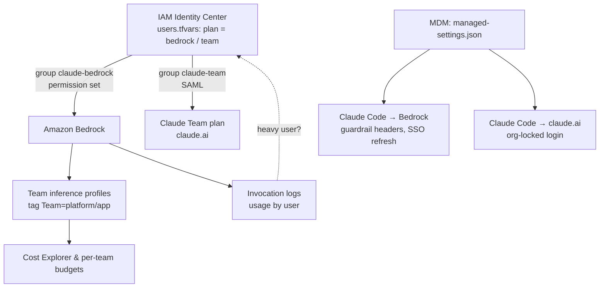

# claude-hybrid-access

**Start everyone on pay-per-token Claude through Amazon Bedrock. Move heavy users to Claude Team seats with a one-word change.** One identity — AWS IAM Identity Center — controls both.

> Original reference implementation, written from scratch. It does not contain or derive from any client's environment.

## Why

Rolling out Claude Code forces an early choice: per-seat plans are predictable but expensive for light users; Bedrock is pay-per-token but harder to govern. This repo avoids the choice:

- **Light users** run Claude Code on Bedrock. You pay only for what they use, per team, with a mandatory guardrail and full logs.
- **Heavy users** get a Claude Team seat (claude.ai + Claude Code), with SSO from the same Identity Center.
- **Moving someone** is one line in `terraform.tfvars` plus a different MDM settings profile. Usage data tells you who to move.



## What's inside

| Path | Contents |
|---|---|
| `terraform/identity.tf` | `claude-bedrock` / `claude-team` groups, memberships from `users`, Claude SAML app assignment |
| `terraform/bedrock.tf` | Per-team application inference profiles (tagged), `ClaudeCodeBedrock` permission set |
| `terraform/cost.tf` | Per-team budgets on the `Team` tag, saved Logs Insights queries (usage by user, daily active users) |
| `terraform/managed_settings.tf` | Renders Claude Code managed settings with the real ARNs |
| `managed-settings/` | Annotated examples and install paths |
| `docs/saml-setup.md` | Identity Center ↔ Claude Team SSO (console steps) |
| `docs/migration.md` | Moving users, offboarding, monthly seat reconciliation |

## Controls

| Concern | Bedrock plan | Team plan |
|---|---|---|
| Who can use it | `ClaudeCodeBedrock` permission set on `claude-bedrock` | SAML app assigned to `claude-team`, Require SSO |
| Which models | Only the team's inference profiles; explicit deny on others | Claude plan settings |
| Content filtering | Guardrail required by IAM (`bedrock:GuardrailIdentifier`), sent by Claude Code as headers | Anthropic-side policies |
| Personal accounts in Claude Code | n/a (AWS credentials only) | `forceLoginMethod` + `forceLoginOrgUUID` |
| Skipping permission prompts | `disableBypassPermissionsMode` | same |
| Cost visibility | Per team (tags) and per user (logs) | Fixed per seat |

## Usage

Prerequisites: the guardrail and invocation logging from [bedrock-secure-access](https://github.com/hiplus0418/bedrock-secure-access) (or your own), Identity Center with users in its directory, and the Claude models enabled in Bedrock.

```bash
cd terraform
cp terraform.tfvars.example terraform.tfvars   # edit
terraform init
terraform apply
terraform output -json managed_settings_bedrock   # per team
terraform output -raw managed_settings_claudeai
```

Then follow [docs/saml-setup.md](docs/saml-setup.md) for the Team plan side.

## Design notes and pitfalls

- **Cross-region profiles need a cross-region guardrail.** Claude Code uses cross-region inference profiles; the guardrail must have cross-Region inference enabled, or calls fail.
- **Two permissions per call.** An inference profile call is authorized on the profile *and* on the foundation model in every destination region, so `model_ids` and `inference_destination_regions` must match the profiles you copy.
- **Pin every model alias.** Unpinned aliases like `/model opus` resolve to built-in model IDs, which IAM denies here. The generated settings map `opus`, `sonnet` and `haiku` to the team's profiles (falling back to `primary`), so `/model` keeps working and cost stays attributed to the team.
- **Pin a numeric guardrail version** in both IAM and the headers. Editing the DRAFT then can't change behaviour silently.
- **The Team plan has no SCIM**, and Identity Center can't push users to SaaS apps. Login is blocked when you remove someone, but the seat stays until removed in Claude. `docs/migration.md` has a monthly reconciliation.
- **Tag-based budgets need tag activation.** Activate `Team` as a cost allocation tag in the management account after first use.
- **Users could still call the system inference profile directly** (same guardrail, same logs, but no team tag). If strict team attribution matters, restrict the system profiles further and verify in your account.

## Requirements

- Terraform >= 1.6, AWS provider ~> 6.69
- Claude Team plan with a verified domain
- An MDM to deliver managed settings

## License

MIT
